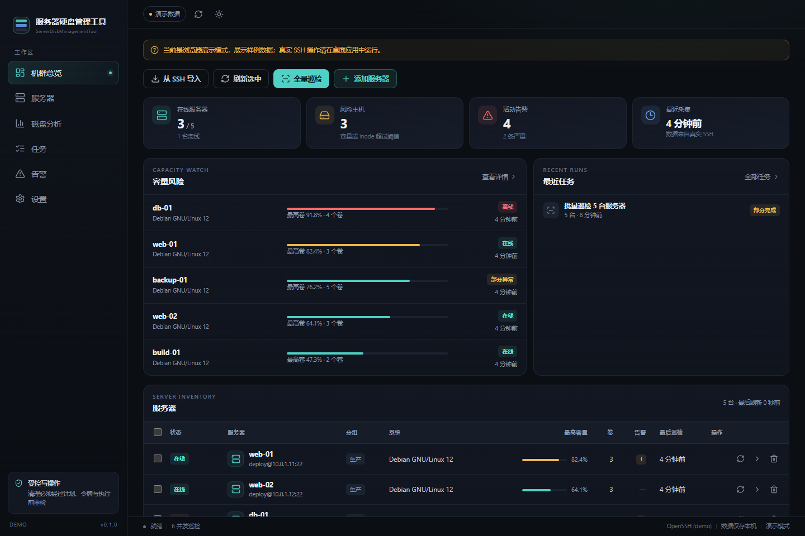

# 服务器硬盘管理工具

ServerDiskManagementTool 是一个面向远程 Linux 服务器的磁盘巡检与空间回收桌面应用。它通过本机 OpenSSH 连接服务器，不需要在远端安装 agent，支持批量查看容量和 inode、按需分析目录占用、查看实时指标，并在明确计划与人工确认下执行受控清理。

技术栈：Tauri 2、Rust、Vue 3、TypeScript。



## 功能

- **服务器接入**：手动添加或从 `~/.ssh/config` 导入；支持 SSH agent、私钥、加密私钥口令和密码；首次连接展示主机指纹并要求确认。
- **批量巡检**：并发读取容量、inode、挂载选项、只读状态、磁盘和系统信息；单台离线不影响其他主机。
- **机群总览**：容量风险、告警、离线状态和最近任务；支持搜索、分组、标签、批量刷新以及 CSV/JSON 导出。
- **空间分析**：按需逐层统计目录占用，提供 Treemap、面包屑和目录列表；大文件扫描支持取消和部分结果。
- **受控回收**：检测包管理器缓存、journal、Docker 和用户缓存，生成逐主机计划；执行前重检，支持模板回收、文件或目录隔离、恢复，以及显式开启后的单文件永久删除。
- **实时指标**：在服务器详情页按需采样磁盘吞吐、IOPS、CPU、内存和负载，离开页面即停止。
- **历史与审计**：SQLite 保存快照、任务、逐主机结果、告警、清理计划、隔离区和审计记录。

## 安全边界

- 远端写操作只来自固定模板和用户在分析结果中明确选择的路径，没有自由命令、通配符或递归删除目录。
- 每次写操作都需要：计划 → 5 分钟一次性令牌 → 执行前重检（路径存在、非符号链接、大小、挂载非只读、工具可用）→ 逐主机结果 → 审计。
- 模板回收和永久删除不可恢复；隔离区文件或目录可在保留期内恢复，清空隔离区才真正释放空间。
- `sudo` 只使用 `sudo -n`，应用不请求也不保存 sudo 密码。
- SSH 密码和口令只写入系统凭据存储（macOS 钥匙串 / Windows 凭据管理器），或仅保留在本次会话内存；SQLite、日志和导出中不含秘密。
- 主机密钥严格校验，使用应用私有 `known_hosts`；未知主机需要人工确认指纹，密钥变化会阻断连接。
- 没有任意远程终端、文件传输、分区/LVM/RAID/挂载修改、云同步或遥测。

更完整的设计见 [docs/Security.md](docs/Security.md)。

## 支持平台

- 客户端：macOS 13+（Apple Silicon 已测试）、Windows 10 1809+ / 11 x64。
- 远端：Linux。较老的 CentOS 7 可以巡检和只读分析，但部分命令可能缺失。
- Windows 需要安装 **OpenSSH Client**，并确保 `ssh -V` 可用。
- 暂不支持 Windows ARM64/x86、Windows 7、Linux 桌面客户端、MSI 安装包和代码签名。

## 快速开始

前置条件：

- Node.js 22.12+ 和 npm；
- Rust stable（1.77+）；
- macOS 需要 Xcode Command Line Tools；Windows 需要 Visual Studio Build Tools（C++）和 WebView2；
- Windows 需要 OpenSSH Client。

```sh
npm ci
npm run desktop:dev
```

构建安装包：

```sh
npm run desktop:build
```

产物位置：

- macOS：`src-tauri/target/release/bundle/macos/服务器硬盘管理工具.app`
- Windows：`src-tauri/target/release/bundle/nsis/服务器硬盘管理工具_0.1.0_x64-setup.exe`

当前构建未做 macOS 公证或 Windows 代码签名，首次运行可能被 Gatekeeper 或 SmartScreen 拦截。

## 测试

```sh
npm run check:frontend
npm run build
cd src-tauri && cargo test
```

前端流程测试使用 Playwright 自带的 Chromium：

```sh
npx playwright install chromium
npm run test:e2e
```

SSH 集成测试需要 Docker，并且会执行隔离和删除操作，只能在一次性环境中运行：

```sh
cd src-tauri && cargo build
cd .. && npm run test:ssh
```

Windows 原生 smoke 和 askpass 测试需要先完成 release 构建：

```powershell
npm run desktop:build
npm run test:windows:smoke
npm run test:windows:askpass
```

## 数据与凭据

- macOS 数据目录：`~/Library/Application Support/com.novarack.desktop`
- Windows 数据目录：`%LOCALAPPDATA%\com.novarack.desktop`
- 数据库：`nova-rack.sqlite3`，保存服务器元数据、快照、任务、告警、计划和审计，不保存密码。
- 凭据：macOS 钥匙串或 Windows 凭据管理器。
- 测试环境可用 `RACK_DATA_DIR` 覆盖数据目录；用 `NOVA_RACK_SSH` 指定 OpenSSH 路径。

## 项目结构

```text
.
├── src/                  Vue 页面、组件、服务层与类型
├── src-tauri/            Rust：SSH、巡检、分析、任务、清理、SQLite
│   └── src/              远端 shell 脚本与解析逻辑
├── tests/                Playwright、Docker SSH 和 Windows smoke 夹具
├── docs/                 实施、安全、SSH 与测试文档
├── LICENSES/             第三方许可证全文
├── public/               图标与 Lucide 许可
├── LICENSE               项目许可证（MIT）
└── THIRD-PARTY-NOTICES.md
```

## 文档

- [实施步骤与完成状态](docs/Implementation-Steps.md)
- [安全设计](docs/Security.md)
- [SSH 与 sudo 配置](docs/SSH-Setup.md)
- [测试记录](docs/Test-Report.md)

## 已知限制

- 远端只支持 Linux；没有 SMART、RAID/LVM 操作、定时后台巡检、邮件或 Webhook 通知。
- 没有免密 sudo 时，系统级回收模板会生成但执行前检查失败；只读分析仍然可用。
- 清理操作没有事务回滚；journal、Docker prune 和永久删除天然不可逆。
- 目录分析和百万文件级性能只做了一般规模验证，尚未提供正式基准。
- 正式分发前需要补齐 macOS Developer ID、公证和 Windows 代码签名。

## 参与贡献

提交 Issue 或 Pull Request 前请阅读 [CONTRIBUTING.md](CONTRIBUTING.md)。安全问题请按 [SECURITY.md](SECURITY.md) 私下报告，不要先开公开 Issue。

## 许可证

本项目以 [MIT License](LICENSE) 发布，Copyright (c) 2026 allintools。

第三方组件及其许可证见 [THIRD-PARTY-NOTICES.md](THIRD-PARTY-NOTICES.md)。
分发安装包时请同时附带该文件和 `LICENSES/` 目录。
